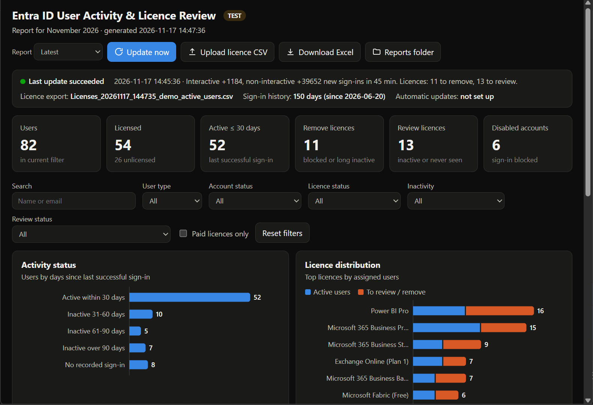
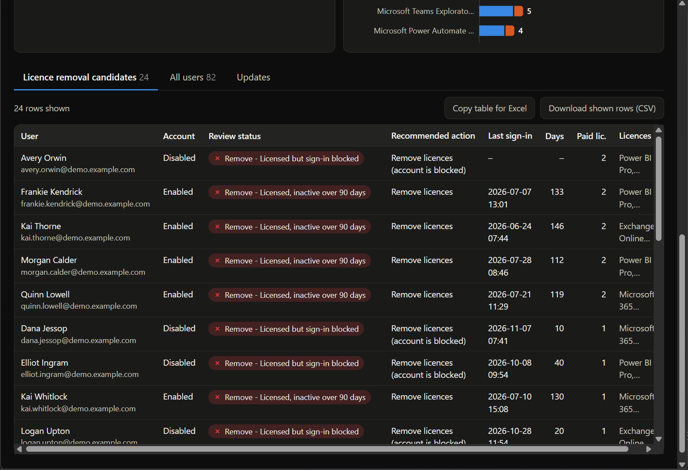
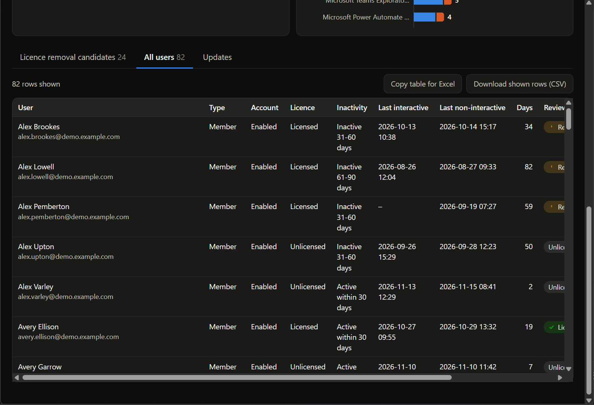
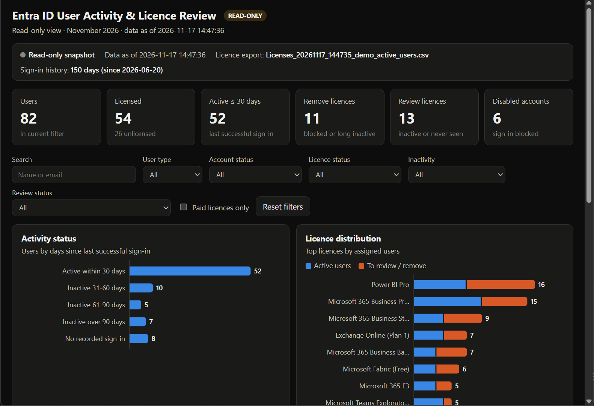

# Entra ID Sign-In Audit & Licence Review

Automated Microsoft Entra ID sign-in collection and a licence-review dashboard, built with **Windows PowerShell 5.1** and **Microsoft Graph**. No servers, no paid tools.

It replaces a fragile monthly 31-day export with small daily collections. From those it keeps a running record of every user's last successful sign-in, compares it with a Microsoft 365 licence export, and produces a list of licences that can be removed.

> All screenshots use **fictional demo data** produced by `Tools/New-DemoData.ps1`. No real tenant, user or company data is included in this repository.



---

## Why it exists

Microsoft Entra ID P2 keeps sign-in logs for only **30 days**, and pulling a whole month in one go was unreliable:

- The non-interactive sign-in stream is large and slow (about 500 rows every 45 seconds on the beta endpoint).
- Long pagination runs failed with **HTTP 410 Gone**, because the `nextLink` / skip token expired part-way through.
- Single requests sometimes **timed out** after five minutes.
- Retry logic only covered 429 and 503 errors.

## What it does

| | |
|---|---|
| **Daily collector** | Runs weekdays at 1 PM, plus a catch-up run 15 minutes after sign-in. Pulls interactive (v1.0) and non-interactive (beta) sign-ins since the last checkpoint. |
| **Resilient paging** | Uses half-open time windows (`ge` / `lt`) cut into 6-hour slices. A slice that hits HTTP 410, a timeout or runs out of retries is **split in half and re-queried**, so an expired `nextLink` is never reused. Retries 429/5xx with back-off. |
| **Safe commits** | Both streams are fully staged before anything is committed. Data is committed in 24-hour chunks, and the checkpoint moves only after a chunk is committed and never moves backwards. An interrupted run (laptop closed) keeps the days it has already finished. |
| **Archive** | Daily CSV partitions (`Archive/<Stream>/yyyy-MM/..._yyyy-MM-dd.csv`), deduplicated by sign-in `Id`, validated, then swapped in atomically (`File.Replace`). |
| **Activity state** | Per-user last successful interactive and non-interactive sign-in (`user_activity.json`). Because it builds up over time, it stays accurate after logs pass the 30-day retention limit. |
| **Licence review** | Upload the Microsoft 365 admin center *Active users* export. Each user gets a verdict: **Remove** (blocked, or inactive over 90 days), **Review** (inactive over 30 days, or no recorded sign-in) or **Active**. Free and trial licences are flagged separately. |
| **Dashboard** | A local desktop app (an Edge app window backed by a localhost-only PowerShell `HttpListener`) with KPI tiles, filters, charts, removal candidates, all users, an update log, **Update now**, **Stop update**, **Pause/Resume schedule**, licence CSV upload, Excel download and copy-to-Excel. |
| **Reports** | Builds an Excel workbook every run and keeps one per month. The `.xlsx` is written directly as OpenXML, so Excel doesn't need to be installed. |
| **Sharing** | Publishes a self-contained **read-only HTML view** plus the Excel file to a shared OneDrive or SharePoint folder for managers. |
| **Notifications** | A Windows toast after every run, plus an update history in the dashboard. |

## Screenshots

| | |
|---|---|
|  |  |
| Overview: run status, KPIs, filters, charts | Licence removal candidates with reason and recommended action |
|  |  |
| All users: interactive / non-interactive activity | Read-only HTML view for colleagues (no actions) |

## Architecture

```
 Task Scheduler (weekdays 1 PM + at logon)                 Desktop shortcut
        |                                                        |
 conhost --headless powershell                           conhost --headless powershell
        |                                                        |
 Export-EntraSignIns_Weekly.ps1  --- Microsoft Graph -->  Start-EntraDashboard.ps1
   - checkpoint / overlap / chunks     auditLogs/signIns     - HttpListener 127.0.0.1 + per-launch token
   - slice split on 410 / timeout                            - Update now / Stop / Pause / Upload CSV
   - stage -> dedupe -> commit                               - Edge --app window (Dashboard/index.html)
        |                                                        |
        +------------> EntraAudit.Common.ps1 <-------------------+
                       - user_activity.json (last sign-ins)
                       - licence rules -> report.json + .xlsx (monthly)
                       - Shared_Reports/ read-only HTML + Excel
```

| Script | Purpose |
|---|---|
| `Scripts/Export-EntraSignIns_Weekly.ps1` | The collector. Run with `-Mode Test` or `-Mode Production`. |
| `Scripts/EntraAudit.Common.ps1` | Shared functions: paths, state, licence rules, XLSX writer, snapshot HTML, toast notifications. |
| `Scripts/Start-EntraDashboard.ps1` | Local dashboard server and app window. |
| `Scripts/Build-EntraReport.ps1` | Rebuilds the report without collecting. |
| `Scripts/Import-SeedActivity.ps1` | Seeds activity history from earlier admin-center sign-in exports. |
| `Scripts/Register-EntraCollectorTask.ps1` | Creates the scheduled task. |
| `Scripts/Install-EntraDashboardShortcut.ps1` | Creates the desktop shortcut. |
| `Tools/New-DemoData.ps1` | Generates fictional demo data for the Test mode. |

## Setup

### 1. App registration

Create an app registration in Entra ID with the **application** permissions `AuditLog.Read.All` and `Directory.Read.All`, then grant admin consent. Reading sign-in logs requires an Entra ID P1 or P2 licence.

### 2. Configuration

```powershell
Copy-Item config.example.json config.json   # config.json is git-ignored
notepad config.json                          # TenantId, ClientId
```

### 3. Store the secret

The client secret is **never** stored in the repository or in `config.json`. It is saved as a DPAPI-encrypted file that only your Windows account on this PC can decrypt:

```powershell
New-Item -ItemType Directory -Force "$env:APPDATA\EntraMonthlyAudit" | Out-Null
Read-Host 'Client secret' -AsSecureString | Export-Clixml "$env:APPDATA\EntraMonthlyAudit\ClientSecret.xml"
```

Also install the Graph authentication module once, if you don't have it: `Install-Module Microsoft.Graph.Authentication -Scope CurrentUser`.

### 4. Try it with demo data (no tenant needed)

```powershell
.\Tools\New-DemoData.ps1
.\Scripts\Start-EntraDashboard.ps1 -Mode Test
```

### 5. Test against your tenant, then go live

```powershell
.\Scripts\Export-EntraSignIns_Weekly.ps1 -Mode Test -TestHours 6    # small, separate Test folder
.\Scripts\Register-EntraCollectorTask.ps1 -Mode Production
.\Scripts\Install-EntraDashboardShortcut.ps1 -Mode Production
```

## Tests performed before production

Every item below was run in Test mode, and each pass was confirmed from the log, not assumed:

- 6-hour collection and an overlapping re-run with **zero duplicate Ids**
- A simulated failure after the interactive stream and before the checkpoint, then recovery with no duplicates and no gaps
- A chunked catch-up run in which the checkpoint never moved backwards
- `-SkipIfRecentHours` (the catch-up trigger exits quietly when a run is recent)
- The scheduled task under Task Scheduler (result 0)
- **Stop update**: a graceful stop between Graph pages, with the checkpoint unchanged
- **Pause/Resume** of the schedule
- Dashboard API token checks, rejection of an invalid licence CSV, and the Excel file opening in Excel
- The read-only snapshot hides every action control

In production, the first run collected 3 days of history (about 49,000 sign-ins) in 105 minutes with 2 retries and no slice splits.

## Lessons learned

- **Never reuse an expired `nextLink`.** Re-query a smaller time window instead.
- **Checkpoint only after the commit**, and never let it move backwards.
- On Windows 11, `powershell -WindowStyle Hidden` under Task Scheduler can be killed (`0xC000013A`) when Windows Terminal is the default console. Launching through `conhost.exe --headless powershell.exe ...` fixes it.
- `SetThreadExecutionState(ES_CONTINUOUS | ES_SYSTEM_REQUIRED)` keeps the PC awake during a run while still letting the screen turn off.
- The admin-center sign-in export is capped at 100,000 rows, so it can't replace the API for busy tenants.

## Security notes

- The dashboard listens on `127.0.0.1` only. A random token is created at each launch and every API call must carry it. The `Host` header is checked.
- The secret is DPAPI-encrypted per user and per machine, and is never written to logs or to the repository.
- `.gitignore` excludes `config.json`, all collected data, logs, reports, CSV/XLSX files and certificate or key files.

## Licence

MIT. See [LICENSE](LICENSE).
